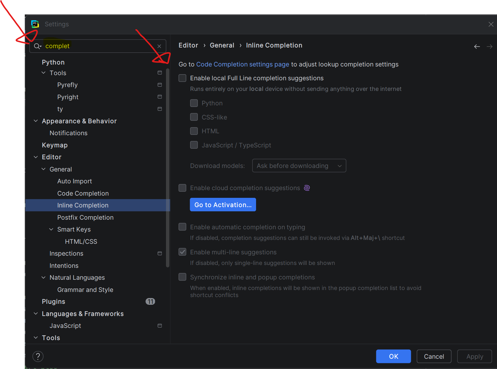
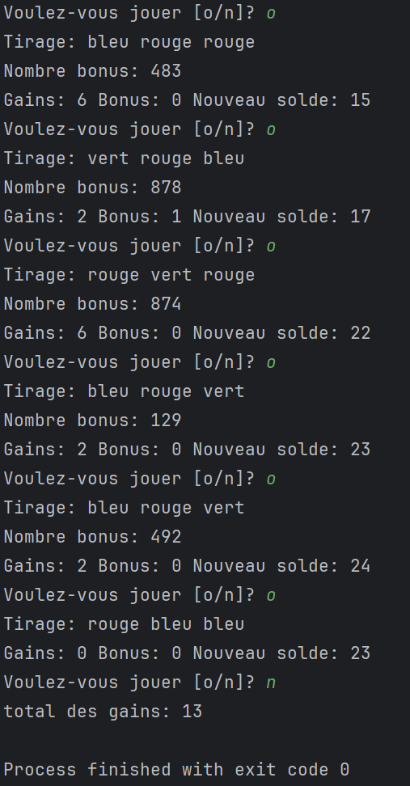

# Examen de Mi-Session partie pratique Automne 2026 gr003

# Instructions
- Inscrire votre nom et numéro de DA dans l'entête de chaque fichier
- Ne pas oublier de faire le "push" pour la remise (vous pouvez utiliser "commit and push" de PyCharm)
  - Si vous avez fait un ou plusieurs "commit" sans faire de "push", vous devez faire un "push" final avant l'heure limite de l'examen
  - Pour ce faire, aller dans `Git` > `Push...` dans PyCharm
- Le fait de faire des "commit and push" permet de remettre votre code au fur et à mesure

# Documentation
- Vous pouvez consulter la documentation officielle sur [python.org](https://docs.python.org/fr/3.14/library/)
  - https://docs.python.org/fr/3.15/builtins/stdtypes.html
- Vous avez accès au dépôt du cours sur github.com pour consulter les exemples vus en classe [420-SF1-RE-A26](https://github.com/plducharme/420-SF1-RE-A26)
- Vous avez aussi accès aux notes de cours dans LÉA.

# Interdictions
- Les IAs sont strictement interdites
- Le "Full inline completion" est interdit et doit être désactivé
  - 

## Loto-Cubes (54 pts)
### Instructions
- Écrire le code dans le module ``loto_3_sur_9.py``
- Ne pas oublier d'inscrire votre nom et votre numéro de DA dans l'entête du fichier

### Énoncé
Vous devez implémenter un jeu de loto qui simule le tirage de cubes de couleurs dans un sac. Maintenant avec tirage bonus!!!

### Requis à implémenter
- Le sac de cube contient 3 cubes bleus, 3 cubes verts et 3 cubes rouges
- Vous devez initialiser une liste nommée ``sac_cubes`` représentant le sac contenant les cubes à partir de la str ``sac_cubes_str`` qui vous est fournie.  
- Le joueur a un solde initial de 10 tickets
- À chaque partie, 3 cubes sont tirés du sac
  - Les cubes sont remis dans le sac entre chaque tirage
    - i.e. La liste de cubes reste toujours la même
- Vous devez définir la fonction ``effectuer_tirage(sac_cubes: list) -> tuple[str, str, str]`` prenant en paramètre la liste de cubes (i.e. ``sac_cubes``) qui retournera 3 str choisies au hasard dans la liste passée en paramètre.
  - Vous devez utiliser la fonction ``random.choice()``
  - afficher les 3 cubes tirés
  - retourner les trois cubes tirés
  - ex: les cubes tirés sont: vert, vert et bleu
    - ``Tirage: vert vert bleu``
- Vous devez définir la fonction ``tirage_bonus(gain: int) -> int``
  - cette fonction permet de calculer les tickets bonus
  - prend en paramètre le gain
  - retourne le nombre de ticket bonus
  - vous devez utiliser ``random.randint()`` pour générer un nombre entre 100 (inclus) et 999 (inclus)
  - Afficher le nombre bonus
      - ex: si le nombre est ``123``
        - ``Nombre bonus: 123``
  - compter le nombre de chiffres pareils
    - Si il n'y a aucun chiffre pareil, retourner 0 ticket bonus
    - S'il y a 2 chiffres pareils, retourner la moitié du gain en bonus
    - S'il y a 3 chiffres pareils, retourner le gain en bonus
    - ex:
      - si la personne gagne 4 ticket et obtient ``666``, retournez 4 tickets en bonus
      - si la personne gagne 4 ticket et obtient ``144``, retournez 2 tickets en bonus
      - si la personne gagne 4 ticket et obtient ``142``, retournez 0 tickets en bonus
- Vous devez définir la fonction ``afficher_gains_bonus(gains: int, bonus: int, nouveau_solde: int) -> None``
  - cette méthode prend en paramètre
    - gain: gain du tirage
    - bonus: gain bonus du tirage
    - nouveau_solde: le nouveau solde après le tirage
  - Elle affiche le gain, le bonus et le nouveau solde
  - L'affichage doit être sous le format:
    - ex: si la personne avait 6 tickets, pour un gain de 4 tickets et 2 tickets bonus
      - ``Gains: 4 Bonus: 2 Nouveau solde: 12``
- Chaque partie coûte 1 ticket pour jouer
  - Le ticket sera déduit de son solde peu importe s'il gagne ou perd
  - Le tirage se fera en faisant appel à la fonction définie ci-dessus
- Les règles de gains sont les suivantes
  - Si le joueur obtient 3 cubes bleus
    - if fait un gain de 10 tickets
    - appeler la fonction ``tirage_bonus()`` en passant le gain en paramètre pour calculer le bonus
    - ajouter les gains et bonus au solde
    - appeler la fonction ``afficher_gains_bonus()``
  - Si le joueur obtient au moins 2 cubes rouges
    - il fait un gain de 6 tickets
    - appeler la fonction ``tirage_bonus()`` en passant le gain en paramètre pour calculer le bonus
    - ajouter les gains et bonus au solde
    - appeler la fonction ``afficher_gains_bonus()`
  - Si le joueur obtient 3 cubes verts
    - il fait un gain de 4 tickets
    - appeler la fonction ``tirage_bonus()`` en passant le gain en paramètre pour calculer le bonus
    - ajouter les gains et bonus au solde
    - appeler la fonction ``afficher_gains_bonus()`
  - S'il obtient 3 cubes de couleurs différentes
    - il fait un gain de 2 ticket
    - appeler la fonction ``tirage_bonus()`` en passant le gain en paramètre pour calculer le bonus
    - ajouter les gains et bonus au solde
    - appeler la fonction ``afficher_gains_bonus()`
  - Dans tous les autres cas, il n'obtient aucun gain et aucun bonus
    - appeler la fonction ``afficher_gains_bonus()`
- Tant que le joueur possède des tickets, vous devez lui poser la question suivante:
  - ``"Voulez-vous jouer [o/n]? ``
    - S'il répond ``o``, on procède à une nouvelle partie
    - S'il répond ``n``, on quitte le jeu en lui indiquant son total de gains ou pertes
      - ex: son solde final est de 14, on affiche ``total des gains: 4``
      - ex: son solde final est de 2, on affiche ``total des pertes: 8``
      - ex: son solde final est de 10, on affiche ``kif-kif``
    - S'il répond un choix invalide, afficher ``Choix invalide`` et redemandez la question
- Si le ne possède plus de tickets, on affiche ``Vous avez perdu!`` et l'on quitte le programme

### Exemple d'exécution

### Barème
- création de la liste de cube (6 pts)
- fonction ``effectuer_tirage()`` (8 pts)
- fonction ``tirage_bonus()`` (10 pts)
- fonction ``afficher_gains_bonus()`` (4 pts)
- boucles de jeu (4 pts)
- Coût du tirage et mise à jour du solde (4 pts)
- Règles de gains (10 pts)
- Affichage exact des messages et questions à l'utilisateur (6 pts)
- Présences de commentaires explicatifs (2 pts)
- Des points sont retirés pour le non-respect des conventions python (PEP-008)

## Vérifications
- Ne pas oublier d'inscrire votre nom et votre numéro de DA dans l'entête de chaque fichier
- Assurez-vous que votre code respecte les conventions de nommage et de style (PEP 8)
- Assurez-vous d'avoir fait un "push" de votre code avant l'heure limite de l'examen
- Vous pouvez toujours vérifier le contenu de votre remise en consultant le dépôt git directement sur github.com